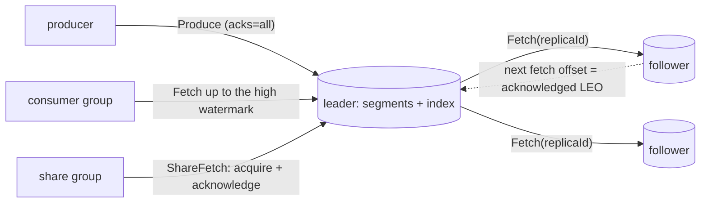

# sluice

A Kafka-style message broker in Go. It is small enough to read in an afternoon and complete enough to
measure: segmented logs with crash recovery, replication under Kafka's ISR rule or a Raft-style majority
quorum, consumer groups, and share groups, Kafka 4.2's queue semantics on a log. Four experiments put
numbers on the trade-offs every log-based system makes.

| Question | What the experiments found (Linux, 4 vCPUs) |
|----------|---------------------------------------------|
| [What does durability cost?](#e1-what-does-durability-cost) | An fsync per write gave 2.3–3k records/s. Group commit gave 56k with 64 producers, and every write was still on disk before its ack. |
| [Log or queue?](#e2-log-or-queue) | When 1% of records were slow, a consumer group fell 7.8 s behind, and adding consumers past the partition count did nothing. A share group stayed within 0.2 s but gave up ordering. |
| [ISR or quorum?](#e3-isr-or-quorum) | The two rules performed the same on a healthy cluster. With one slow follower, the ISR rule dropped to 149 records/s and the quorum stayed at 5.9k. |
| [Does zero-copy matter?](#e4-does-zero-copy-matter) | `sendfile(2)` gave 13% more read throughput and used 10% less CPU per GiB, on loopback. |

## Quick start

You need Go 1.27. Docker is needed for the three-broker cluster and for the Linux numbers.

**1. Build and test.**

```
git clone https://github.com/fimkap/sluice.git
cd sluice
make race
```

This runs every test with the race detector in about 30 seconds. The tests include crash recovery,
three-broker clusters in one process, and consumer-group and share-group semantics.

**2. Run one broker**, then talk to it from a second terminal:

```
go run ./cmd/sluice --data-dir /tmp/sluice
```

```
go run ./cmd/sluicectl create-topic -topic orders -partitions 3
printf 'one\ntwo\n' | go run ./cmd/sluicectl produce -topic orders -key customer-7
go run ./cmd/sluicectl consume -topic orders -group demo -from-earliest -n 2
```

**3. Run three brokers** with replication factor 3:

```
docker compose up -d
docker compose run --rm cli create-topic -topic orders -partitions 3 -rf 3
docker compose run --rm cli topics
```

`topics` shows each partition's leader, replicas and in-sync replicas. Prometheus metrics are at
`localhost:9100/metrics` (and 9101, 9102 for the other brokers); `docker compose down -v` removes
everything.

**4. Rerun the experiments:** `make bench` runs them on this machine, `make bench-docker` inside Linux as
reported below. The run takes about two minutes.

## The experiments

The numbers below are from `make bench-docker` on an M1 MacBook (Docker Desktop, 4 vCPUs, Linux 7.0). The
raw output is in [docs/results/](docs/results). Each experiment starts real brokers in one process,
talking over loopback TCP and writing real files. Inside Docker Desktop's VM an fsync is much cheaper than
on bare hardware (see the macOS numbers in E1), so read the ratios rather than the absolute values.

### E1: What does durability cost?

Here 1 KiB records are produced with `acks=1` to one partition. Each producer has its own connection and
one record in flight.

| fsync policy | producers | records/s | p50 | p99 | appends per fsync |
|---|---:|---:|---:|---:|---:|
| none | 1 | 35k | 0.02 ms | 0.08 ms | only at segment roll |
| none | 64 | 126k | 0.06 ms | 2.04 ms | only at segment roll |
| interval (100 ms) | 64 | 133k | 0.07 ms | 2.13 ms | 10810 |
| always | 1 | 2271 | 0.43 ms | 0.78 ms | 1.0 |
| always | 64 | 3036 | 19.0 ms | 36.2 ms | 1.0 |
| group | 1 | 2909 | 0.33 ms | 0.61 ms | 1.0 |
| group | 16 | 21k | 0.74 ms | 1.21 ms | 8.0 |
| group | 64 | 56k | 1.07 ms | 3.22 ms | 31.8 |

- **`always` doesn't scale.** It fsyncs under the log lock, so 64 producers queue behind one disk flush
  at a time, and latency grows with the queue.
- **Group commit is just as durable, but writes share the fsync.** Producers append to the page cache.
  A flusher goroutine runs one `fdatasync` for everything written so far and releases every waiter that
  sync covers. With 64 producers, 32 appends shared each fsync, for 18× the throughput of `always`.
- **One producer gets nothing from group commit:** it has no one to share an fsync with.
- On macOS, where `File.Sync` issues `F_FULLFSYNC` (a real flush of the drive's cache, about 4 ms), `always`
  managed 289 records/s and group commit 3,188 with 64 producers
  ([macOS run](docs/results/macos-arm64-durability.md)).

### E2: Log or queue?

A topic with 4 partitions gets 1,000 records/s for 5 s. Each consumer handles one record at a time: 1 ms
of work for most records, but every 100th takes 200 ms. Latency is measured from produce to the end of
processing, for the fast records only, so it shows how long they waited behind slow ones.

| model | consumers | drained in | fast p50 | fast p99 | fast max | records out of order |
|---|---:|---:|---:|---:|---:|---:|
| consumer group | 4 | 12.9 s | 3.00 ms | 7504 ms | 7778 ms | 0 |
| consumer group | 8 | 13.0 s | 3.18 ms | 7569 ms | 7840 ms | 0 |
| share group | 4 | 5.2 s | 3.72 ms | 203 ms | 207 ms | 330 |
| share group | 8 | 5.2 s | 2.37 ms | 192 ms | 205 ms | 204 |
| share group | 16 | 5.2 s | 2.28 ms | 158 ms | 203 ms | 162 |

- **A consumer group is bound to its partitions.** Each partition belongs to one consumer and is read in
  order, so a slow record blocks every record behind it in that partition. Four partitions can't keep up
  with this load: the backlog grew to 7.8 s. Eight consumers did no better, because four of them had no
  partition to read.
- **A share group is a queue.** Any member takes any record, under a time-limited lock, and acknowledges it
  on its own. All five runs drained as fast as records arrived. The price is ordering: up to 330 records
  were processed out of partition order.
- **Share groups don't remove waiting entirely.** A consumer working on a slow record still holds the
  records it already fetched, here up to one per partition. That is where the ~200 ms p99 comes from.

### E3: ISR or quorum?

Three brokers, replication factor 3, `fsync=group`, 8 producers with `acks=all`. The slow follower sleeps
20 ms before every fetch.

| commit rule | followers | acks | records/s | p50 | p99 |
|---|---|---|---:|---:|---:|
| ISR | healthy | 1 | 5358 | 1.29 ms | 5.22 ms |
| ISR | healthy | all | 4849 | 1.42 ms | 5.74 ms |
| quorum | healthy | all | 5656 | 1.25 ms | 4.70 ms |
| ISR | one slow | all | 149 | 54.7 ms | 66.8 ms |
| quorum | one slow | all | 5854 | 1.15 ms | 3.91 ms |

- **Kafka's ISR rule** commits a record once every in-sync replica has it. A follower is in sync if it
  caught up within `replica.lag.time.max` (10 s). A slow follower that keeps fetching never falls outside
  that window, so it stays in the ISR, and every `acks=all` produce waits for it.
- **The quorum rule** (Raft's) commits once a majority has a record, so the fastest two of three set the
  pace and the slow one doesn't matter.
- **The trade-off runs the other way for failures.** With 3 replicas, a quorum survives one failure. The ISR
  rule can keep accepting writes with fewer replicas, down to `min.insync.replicas`. This is why Kafka keeps
  the ISR rule for data even though KRaft uses Raft for metadata.

### E4: Does zero-copy matter?

A consumer reads one partition of 512 MiB end to end, 1 MiB per fetch, without decoding the records. The
table shows the best of three passes over a warm page cache.

| fetch path | GiB/s | CPU seconds per GiB |
|---|---:|---:|
| `sendfile(2)` | 3.90 | 0.46 |
| read + write | 3.46 | 0.51 |

Because a batch is stored exactly as it was sent, the broker can hand the kernel a file range and never
copy it through user space. Here that bought 13% more throughput and 10% less CPU per GiB. On loopback,
the consumer's own receive copy is part of the CPU number, so this understates what the broker saves.

## How it works



- **One byte format.** A record batch is identical on the wire and on disk. The CRC-32C covers everything
  except the base offset, so the leader assigns offsets by writing 8 bytes in place, and fetches can be
  served straight from the file.
- **The log** is a sequence of segment files with a sparse index. When the log opens, the active segment is
  scanned and truncated at the first batch that is torn or fails its CRC. Retention never deletes a segment
  that a fetch is still reading.
- **In order, out of order.** Each connection applies its requests in order on its read loop, so appends
  keep their order. Waiting for durability, replication or new data happens on separate goroutines, so a
  slow request doesn't block the ones behind it.
- **Replication** is pull-based. A follower's next fetch offset tells the leader what the follower has
  acknowledged. Under `always` or `group`, acknowledged means on disk. The high watermark follows the ISR
  rule or the quorum rule.
- **Consumer groups** work as in KIP-848: members heartbeat, and the coordinator computes the assignment. A
  partition moves only after its old owner has given it up.
- **Share groups** work as in KIP-932. Records go from available to acquired (under a lock) to acknowledged
  or archived. Consumers acknowledge with ACCEPT, RELEASE, REJECT or RENEW, and a record is archived after a
  delivery limit. The start offset is checkpointed, which gives at-least-once delivery.

The full semantics, and the tests that pin each rule, are in [docs/design.md](docs/design.md).

## Tests

`make race` runs everything with the race detector, and `make fuzz` runs the decoders' fuzz targets. The
tests are written to break things:

- they tear and corrupt log tails and reopen the log;
- they delete an index file;
- they let retention delete a segment while it is being read;
- they stop a follower and watch it leave the ISR;
- they check after every poll that no partition has two owners;
- they check that each share-group record is delivered once while its lock holds.

## Deploying to AWS

[deploy/terraform](deploy/terraform) runs three brokers on Graviton EC2 instances, one per availability
zone, each with its own gp3 volume. Images come from ECR, logs go to CloudWatch, and you reach the hosts
with SSM. The stack also adds a bench host for measuring fsync on EBS. The guide there covers build, push,
apply and destroy. It passes `terraform validate` but hasn't been applied from this repository.

## Limits

These are deliberate, to keep the code readable:

- no leader failover;
- topic metadata is broadcast to the brokers rather than agreed through consensus;
- one partition per produce or fetch request;
- no TLS, authentication, compression, transactions or compaction.

`docs/design.md` describes what failover would need.

## How it was built

I chose the problem, a Kafka-style broker that compares approaches and measures them, and the constraints:
measured, run in Docker, and deployable to AWS. Claude Code drafted the spec and wrote the code in steps.
[docs/ai-workflow.md](docs/ai-workflow.md) shows what kept that work checkable:

- the invariants in [AGENTS.md](AGENTS.md);
- the guardrails in [.claude/](.claude);
- the tests and experiments above.

It also lists what the checks caught, such as a rebalance bug that handed one partition to two consumers at
once.

## Layout

| Path | Contents |
|------|----------|
| `internal/record` | batch format |
| `internal/logstore` | segments, index, recovery, retention, fsync policies |
| `internal/protocol`, `internal/wire` | protocol messages; pipelined connection |
| `internal/broker` | server, replication, consumer groups, share groups |
| `client` | Go client |
| `cmd/sluice`, `cmd/sluicectl`, `cmd/sluice-bench` | broker, CLI, experiments |
| `deploy/terraform` | AWS |

MIT licensed.
